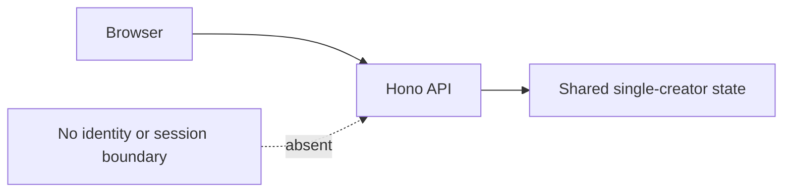

# Authentication and authorization flow

## Current implementation

There is no registration, login, logout, session, cookie, JWT, password store, identity provider, or role/permission model in the current source tree. The UI assumes one demo creator, Aanya Kulkarni. All API routes operate on the same state and do not identify a caller.

## Access controls that do exist

- The API defaults to binding on `127.0.0.1`.
- CORS allows exact configured local origins by default.
- Supabase migration enables RLS and denies `anon` and `authenticated` table grants; server access uses a secret key.

These controls do not authenticate callers. CORS is a browser policy, loopback binding is a local-development boundary, and the server-side Supabase secret bypasses RLS. A network deployment or multiple-creator rollout requires authentication, per-user ownership checks on every endpoint, and owner-scoped persistence/RLS before use.

## Feature status

Authentication is **Missing** and tested as absent through repository/source inspection, not a runtime login test. There is no login flow to diagram beyond the missing boundary above.
