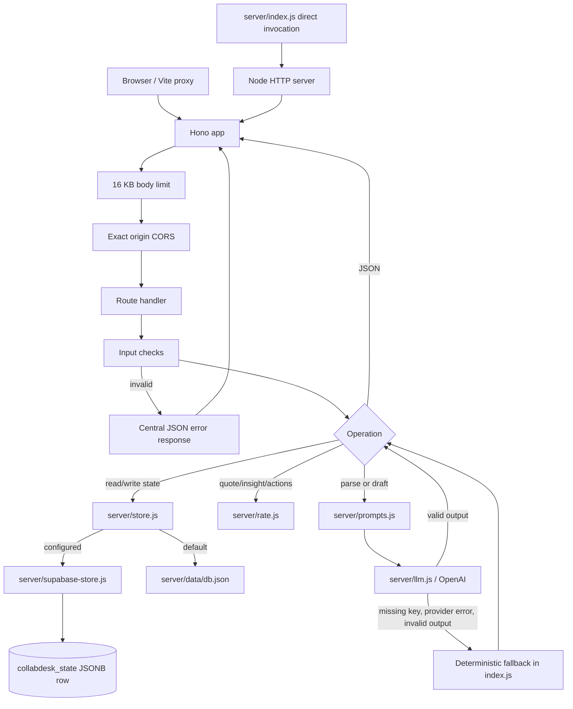

# Backend flow

## Server and middleware

`server/index.js` creates a Hono app and exports it for in-process tests. When run as a script, it starts `@hono/node-server` on `HOST`/`PORT` (defaults `127.0.0.1:3001`). Under `/api/*`, request bodies are limited to 16 KB, CORS accepts only exact origins in `ALLOWED_ORIGINS`, and a global error handler converts malformed JSON to 400 and other errors to a JSON response. No authentication, authorization, or request logging middleware is present.

## Handler/service map

| Concern | Source | Responsibility |
| --- | --- | --- |
| HTTP routes, validation, response shaping | [`server/index.js`](../../server/index.js) | Hono endpoints and error boundary |
| Persistence selection and serialized file updates | [`server/store.js`](../../server/store.js) | Local JSON default or Supabase adapter; atomic file replacement and in-process write queue |
| Supabase persistence | [`server/supabase-store.js`](../../server/supabase-store.js) | REST calls, seed row, revision compare-and-swap retries |
| Quotes, insights, Today actions | [`server/rate.js`](../../server/rate.js) | Deterministic calculations |
| Prompt construction | [`server/prompts.js`](../../server/prompts.js) | Email extraction and reply instructions |
| Provider client | [`server/llm.js`](../../server/llm.js) | Optional OpenAI Chat Completions request with 10-second timeout |
| Sample input fixtures | [`server/samples.js`](../../server/samples.js) | Three demo email samples |

## Backend flow

## Validation and error behavior

Creator profile input requires bounded niche/followers and positive bounded rates. Deal status and reply intent are allowlisted. Email input is required and limited to 10,000 characters in addition to the global body limit. Model output is checked for field types and lengths before it is stored or returned; invalid provider results fall back. The generic error handler avoids returning internal exception text for HTTP 500. There is no structured logging or observability configuration in this checkout.
