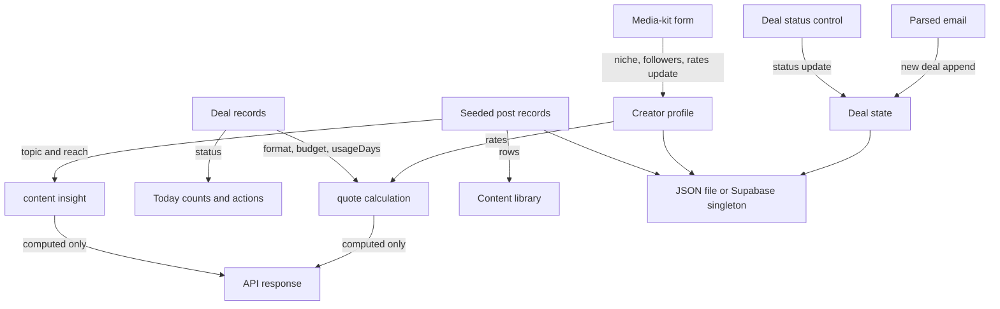

# Database flow

## Data model

The canonical state document is visible in [`server/data/db.json`](../../server/data/db.json):

- `creator`: one profile with name, handle, city, niche, follower count, rates, and rules.
- `deals[]`: deal identity, brand, intent, format, budget, deadline, deliverables, summary, status, usage days, and created timestamp.
- `posts[]`: seeded post title/type/topic, reach, saves, and collaboration flag.

There are no normalized relationships or foreign keys. `deals` and `posts` are arrays inside one state document. Quotes and insights are calculated at request time rather than persisted. The UI’s media-kit editor can change niche, followers, and rates; the API preserves the other creator profile fields.

## Storage modes

| Mode | Selection | Read/write behavior |
| --- | --- | --- |
| JSON file (default) | `DATABASE_PROVIDER` absent or `file`; path may be changed using `COLLABDESK_DB_PATH` | Reads JSON per operation. `updateStore` serializes updates within one process and uses temp file + rename for writes. |
| Supabase | `DATABASE_PROVIDER=supabase`, `SUPABASE_URL`, `SUPABASE_SECRET_KEY` | Uses Supabase REST/Data API against `public.collabdesk_state`; first read seeds an absent singleton from local JSON; update uses revision compare-and-swap and retries up to five times. |

Migration [`supabase/migrations/202610230001_collabdesk_state.sql`](../../supabase/migrations/202610230001_collabdesk_state.sql) creates one row constrained to ID `default`, JSONB payload, revision, and timestamp. RLS is enabled and privileges are revoked from `anon` and `authenticated`; backend `service_role` gets table access. This protects the table from direct client roles but the server secret bypasses RLS and there is still no user ownership.

## Feature-to-data flow

| Feature | Data operations | Implementation |
| --- | --- | --- |
| Profile / Media kit | Read creator; update niche, followers, rates | `GET/PUT /api/creator` |
| Deal board / detail | Read deals; update status | `GET /api/deals`, `GET/PATCH /api/deals/:id` |
| Email parse | Read creator for quote; append deal | `POST /api/inbox/parse` |
| Quote | Read creator rates and deal format/budget/usage | list/detail/rate/reply routes, `server/rate.js` |
| Content | Read posts and calculate topic reach averages | `GET /api/content`, `server/rate.js` |
| Today | Read deals and posts; derive counts/actions | `GET /api/today`, `server/rate.js` |
| Reply draft | Read deal and creator rates; return computed draft only | `POST /api/deals/:id/reply`; no state write |

## Data safety limits

The file mutation queue protects only one Node process; concurrent independent app instances using the same JSON file can still race. Supabase’s one-row JSONB design is single-creator and causes all updates to contend on one revision. No production database credentials were available or used during audit.
