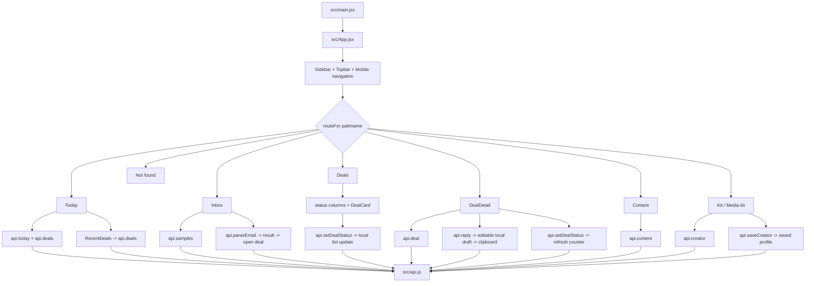

# Frontend flow

## Routes and shared shell

`src/App.jsx` implements history-based routing without a routing library. `routeFor()` recognizes `/`, `/inbox`, `/deals`, `/deals/:id`, `/content`, and `/kit`; unrecognized addresses now render a not-found page. `popstate` updates the rendered route. The fixed sidebar, workspace header, error banner, and mobile navigation wrap every route. The stylesheet contains breakpoints at 1100, 760, and 430 pixels, but responsive rendering was not browser-verified.

| Route | Main view | Data/API calls | Main actions |
| --- | --- | --- | --- |
| `/` | `Today` + `RecentDeals` | `/today`, `/deals` | Open suggested deal; navigate to Inbox, Content, Deals |
| `/inbox` | `Inbox` | `/samples`, `/inbox/parse` | Load sample, paste email, parse, open created deal |
| `/deals` | `Deals`, `DealCard` | `/deals`, `PATCH /deals/:id` | Open detail; move deal one step backward/forward |
| `/deals/:id` | `DealDetail`, `Fact` | `/deals/:id`, `/reply`, `PATCH /deals/:id` | Draft reply, edit draft locally, copy draft, change status |
| `/content` | `Content` | `/content` | Inspect seeded post rows and computed averages |
| `/kit` | `Kit` | `/creator`, `PUT /creator` | Edit niche, followers, and three rates; preview rate card |
| other | not-found message | none | Return to Today |

## State and data behavior

State uses React `useState`, `useEffect`, `useMemo`, and `useCallback` only. There is no shared state library or persistent browser state. `api.js` sets JSON headers, parses JSON responses, and turns network/non-2xx outcomes into errors. Views display loading indicators and error messages; empty deal-board columns have an explicit empty message. The Content page has loading/error states. No request cancellation or stale-response guard is implemented.

The app-level refresh counter now remounts the active view so its page data is fetched again. Creator profile is fetched on that same counter. Form success state is local to Kit; parse result is local to Inbox; edited reply fields are not persisted and the API has no send endpoint.

## Frontend flow diagram

## Interaction details and limits

- `Inbox` has sample selection and required textarea validation. Its parse button reports loading and API errors. Parse results show quote facts; the offline parser is explicitly labeled.
- `Deals` disables status buttons while that deal saves and updates the local board after a successful API response.
- `DealDetail` disables reply actions while generating a draft, lets the user edit subject/body, and copies to clipboard. There is no message-sending control or persistent draft storage.
- `Kit` uses native input constraints and server-side validation, shows a saved indicator, and updates its preview from the editable form.
- Buttons and links have visible focus styling in CSS; no automated accessibility audit was run.
