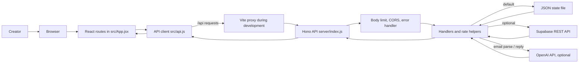
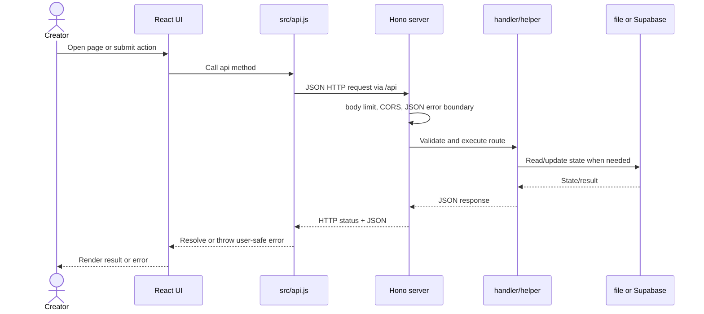

# System architecture

## Stack and boundaries

CollabDesk is a single-repository JavaScript application. The browser UI uses React 18 and Vite. The API is a Node.js 20+ process using Hono and `@hono/node-server`. Vite proxies `/api` to the API on loopback during development. There is no separate frontend server in production configuration here; `npm run build` emits static assets to `dist/`, while the API remains a separate process.

Persistence defaults to `server/data/db.json`. Optional Supabase Postgres persistence stores the whole single-creator state document in one JSONB row. OpenAI Chat Completions is optional for email extraction and reply drafting; deterministic fallback code runs when unavailable. No auth, social platform connection, upload system, payment provider, or message delivery integration exists.

## Runtime and entry points

- Browser document: [`index.html`](../../index.html)
- React mount and stylesheet: [`src/main.jsx`](../../src/main.jsx)
- Route selection, pages, and UI state: [`src/App.jsx`](../../src/App.jsx)
- Browser API wrapper: [`src/api.js`](../../src/api.js)
- API app and standalone server entry: [`server/index.js`](../../server/index.js); the listener starts only when invoked directly.
- Development proxy and host/port: [`vite.config.js`](../../vite.config.js)
- Build/test scripts: [`package.json`](../../package.json)

## Overall application request

The app currently has no authentication stage. Hono applies a 16 KB body limit, an exact-origin CORS allowlist, and centralized JSON errors under `/api/*`. Request-specific validation happens in route handlers. Those handlers call store operations, calculation helpers, or OpenAI. Responses are JSON and the UI handles local loading/error/success state.

## Important operating constraints

The API defaults to `127.0.0.1:3001`, because there is no login or user isolation. Supabase service credentials bypass RLS and are server-side only. The application data is seeded demo content, not live creator analytics. Do not expose the API to a network or use this data model for multiple creators before adding authenticated ownership boundaries.
